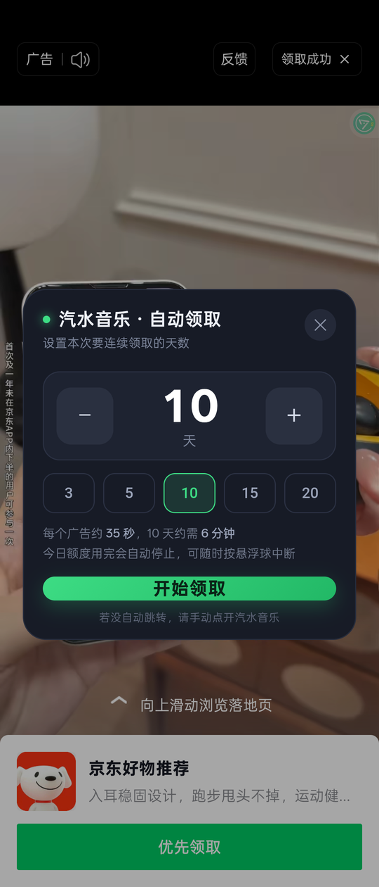
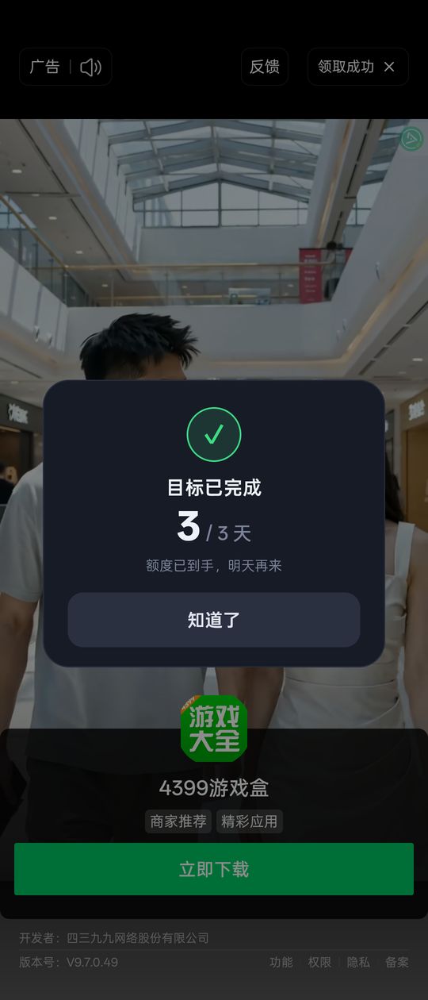

# 汽水音乐 · Android 自动领取「免费听」

> 用 AScript（Android）自动完成「看广告 → 领免费听时长」这套重复操作。
> 控件树定位，不用 OCR；运行前弹卡片设置目标天数，点「开始领取」才动手。
>
> **已在 OPPO / Android 16 / ColorOS 16（1080×2520）真机跑通完整闭环**：连续 10 轮、累计领取 7 次，零崩溃、零误点。

<p align="center">
  
  
</p>

<p align="center"><sub>运行前设置目标天数（左）· 跑完后的结果反馈（右）</sub></p>

---

## ⚠️ 先读这一段

这个项目**做的是自动化刷广告换会员时长**，属于违反平台用户协议的行为。公开发布仅为技术交流，请自行评估：

- 可能被**清空已获时长、限制功能、甚至封号**
- 行为特征很明显（固定节奏、连续几十轮、零交互），不存在「不会被发现」的技术
- 需要长期亮屏运行，**建议只用备用机**

涉及具体 App 的商标、内容版权均归其权利人所有，本项目与之无任何关联。**作者不对使用后果负责，也不提供任何形式的保证。**

---

## 一、它做什么

汽水音乐每天有「看广告换免费听时长」的额度，手动一轮轮点很烦。脚本接管的就是这段循环：

```
播放页「免费听」 → 广告页（等 30s 倒计时）
        ↑                    ↓
   自动进下一条     →   右上角「领取成功」→ 弹窗「领取奖励」
                            ↓（奖励到账）
                    不定期弹「第N天畅听」进度面板 → 自动关掉
```

一轮约 35 秒。设 10 天大约 6 分钟跑完。

## 二、为什么用控件树而不是 OCR

| | OCR 方案（iOS 版做法） | 控件树方案（本项目） |
|---|---|---|
| 原理 | 截图 → 识别文字 → 猜坐标 | 直接读无障碍树拿控件坐标 |
| 依赖分辨率 | 强，换机就要重调 | 无，坐标由系统给 |
| 单次耗时 | 0.3~0.6s | 毫秒级 |
| 失败原因 | 背景干扰、亮度变化、字体渲染 | 只受「文案改版」影响 |

Android 的无障碍能读到 WebView 里的 `content-desc`，所以广告页那种自绘页面也能精确命中。代价是**文案一变就要跟着改**（见「改版自救」）。

## 三、环境要求

| 项 | 要求 |
|---|---|
| 手机 | Android 7.0+，已 root 与否都行 |
| AScript | [ascript.cn](https://www.ascript.cn) 的 Android 版 App（本项目在 4.0.17 上验证） |
| AScript 权限 | **无障碍**（必须）、悬浮窗（界面需要）、图色（探针可选） |
| 电脑（可选） | Node.js 18+（用 `run.js` 看日志），或直接用浏览器 |
| 汽水音乐 | 自己装好并登录 |

> **不需要**越狱 / ESP32 / 电脑端插件。iOS 版必须外接硬件是因为 WDA 的点击是「注入事件」会被识别；Android 走无障碍 `action.click()` 是系统级原生模拟。

## 四、部署

### 1. 装 AScript 并授权

装好 App 后开启**无障碍服务**和**悬浮窗权限**，否则一行都跑不动。

### 2. 建工程并传代码

AScript 在手机上会开一个 **9096 端口的 Web 服务**，浏览器直接访问就能管理工程，不需要装 VS Code 插件：

```bash
# 已知手机 IP 为 192.168.1.20，先建工程
curl "http://192.168.1.20:9096/api/model/create?name=qishui"
```

工程路径一般是 `/storage/emulated/0/airscript/model/qishui`（开了「应用分身」则是 `/storage/emulated/10/...`）。

然后上传三个文件（路径按你的实际情况替换）：

```bash
BASE="http://192.168.1.20:9096"
DIR="/storage/emulated/0/airscript/model/qishui"

curl -X POST -F "data=@__init__.py"                "$BASE/api/file/upload?path=$DIR/__init__.py"
curl -X POST -F "data=@res/ui/panel.html"          "$BASE/api/file/upload?path=$DIR/res/ui/panel.html"
curl -X POST -F "data=@res/ui/result.html"         "$BASE/api/file/upload?path=$DIR/res/ui/result.html"
```

也可以打开 `http://<手机IP>:9096` 用网页编辑器直接粘贴。

> Windows 下用 Git Bash 执行 curl 时，加 `MSYS_NO_PATHCONV=1` 避免路径被自动转换。

### 3. 运行

**手机上**：AScript → 小程序列表 → `qishui` → 运行

**电脑上**：

```bash
node run.js 192.168.1.20          # 启动 + 实时日志
node run.js 192.168.1.20 stop     # 停止
```

用 `./run.sh`（Linux/macOS）或 `.\run.ps1`（Windows）也可以，参数一样。

启动后会弹设置卡片。**点「开始领取」才真正开始**，点 ✕ 就什么都不做。

### 4. 保活（国产 ROM 必做）

不做的结果就是跑几分钟被系统静默杀掉。以 ColorOS 为例：

| 位置 | 操作 |
|---|---|
| 应用管理 → AScript → 耗电管理 | 允许后台运行 |
| 电池 → 更多设置 | 关闭「睡眠待机优化」 |
| 应用 → 自启动管理 | 允许自启动 |
| 最近任务 | 下拉锁定 AScript 卡片 |
| 应用管理 → AScript → 权限 | 允许「后台弹出界面 / 关联启动」 |

最后一项决定脚本能不能自己把汽水音乐拉到前台。不给也行，脚本会提示你手动打开，然后自动接管。

## 五、交互界面

用 AScript 的 `WebWindow`（WebView 悬浮窗）实现，界面是工程里的 `res/ui/panel.html`。

| 操作 | 结果 |
|---|---|
| 点「开始领取」 | 关卡片 → 启动/接管汽水音乐 → 按设定天数循环 |
| 点右上角 ✕ | 直接退出，**不点任何东西** |
| 300 秒不操作 | 自动退出（防误触后无人确认就开刷） |
| 天数范围 | 1~60，+/− 或快捷值；上次的值会记住 |
| 跑完 | 再弹结果卡：「目标已完成 3/3 天」或「提前结束 1/3 天」 |

通信方式：JS 侧 `window.airscript.call('start', '10')` → Python 侧 `@w.on("start")` 接收（值恒为**字符串**，记得转换）。

不用界面就设 `SHOW_UI = False`，直接用 `UI_TARGET_DEFAULT` 跑，适合定时任务。

## 六、实现要点（踩过的坑都在这里）

**契约层：抓到的真实控件**

| 层级 | uiautomator dump 原文 | 坐标（1080×2520） |
|---|---|---|
| 入口 | `TextView text="免费听"`（会变「免费听1天」等，同一节点） | 约 (750, 1991) |
| 广告中 | `ViewGroup desc="30秒后可领取奖励，关闭，按钮"` | x776-1032　y120-216 |
| 广告结束 | `ViewGroup desc="领取成功，关闭，按钮"` | 同上 |
| 领取按钮 | `desc="领取奖励"` | (540, 1342) |
| 弹窗兜底 | `desc="坚持退出"` | (540, 1506) |
| 进度面板 | `desc` 含「天畅听」 | 领取后不定期弹出 |

**坑 1 · 「领取成功」和「×」是同一个控件**

`desc` 拼成 `"领取成功，关闭，按钮"`，右边约 1/3 是关闭按钮。**点控件中心会把广告关掉而不是领奖**。代码按控件框宽的 42% 取点，稳定落在文字上。

**坑 2 · 领取后不一定直接进下一个广告**

经常会弹「第N天畅听」进度面板挡住播放页。不处理，第二轮必卡死。检测到 `desc` 含「天畅听」就按返回键关掉。

**坑 3 · 每秒多次全量扫描会把进程拖死**

第一版每秒 3~4 次 `find_all()` + XPath 查询，脚本跑约 50 秒**静默停止**（无报错、无 Traceback）。原因是广告页 WebView 在倒计时期间持续刷新。改成每轮只扫一次、去掉 XPath 后稳定。

**坑 4 · 启动后不能立刻查控件**

`launch_app()` 后立刻查询会读到旧窗口（实测启动后 20ms 查询必失败）。必须轮询到特征文案出现再用。

**坑 5 · `system.open()` 在国产 ROM 上可能被拦**

AScript 在后台时拉不起目标 App。脚本会提示并等待，你手动打开它自动接管；根治要开「后台弹出界面」权限。

**坑 6 · 硬编码日志路径会在换机后失效**

主空间是 `/storage/emulated/0`，应用分身是 `/storage/emulated/10`。代码用 `__file__` 反推 + 多级兜底。

**其他设计取舍**

- **只检测不误点**：等待阶段全程只读，点击只由一个函数执行
- **绝不点「立即下载」**：广告页底部那个是诱导安装按钮，所有点击都来自精确控件坐标，物理触碰不到
- **两种成功分支**：常规「领取奖励」弹窗和「第N天畅听」面板都算成功
- **日志落盘**：每行同时写 `run.log`。WebSocket 日志通道（10102）时好时坏，文件是唯一稳定通道，崩溃前最后一行也读得到

## 七、App 改版了怎么办

改版通常只破坏两样东西：**文案** 和 **位置**。位置由系统给，不用管；文案需要重抓。

```python
SELFTEST = True     # 改这个开关，跑一次
```

探针模式会把当前界面所有控件的 `text` / `desc` / 坐标打印到日志，照着改 `__init__.py` 顶部的常量即可：

```python
ENTRY_PATTERN = ".*免费听.*"        # 入口（正则，不是精确匹配）
ENTRY_EXCLUDE = ("今日免费听", "会员")  # 排除同名弹窗标题和底部 tab
REWARD_DESC = "领取奖励"
EXIT_DESC = "坚持退出"
CLAIM_DESC_KEY = "领取成功"          # desc 是拼接串，用包含匹配
COUNTDOWN_DESC_KEY = "秒后可领取奖励"

SHOW_UI = True
UI_TARGET_DEFAULT = 10
UI_TARGET_MIN, UI_TARGET_MAX = 1, 60
UI_WAIT_TIMEOUT = 300

ENTRY_TIMEOUT = 150                 # 等入口出现（含你手动开 App 的时间）
MAX_IDLE_ROUNDS = 8                 # 连续几轮没广告就判定额度用完
CLAIM_WAIT = 45                     # 单条广告最长等待
CLAIM_CLICK_RATIO = 0.42            # 领取成功取点比例，别调大（右边是 ×）
```

## 八、已知限制

| 限制 | 说明 |
|---|---|
| 额度判断是启发式 | 没有读额度的接口，靠「连续 8 轮没广告」推断，额度真用完会多等一轮 |
| 入口只认「免费听」 | 「解锁第N天畅听」不是已验证的广告入口，代码不点它，避免误触会员页 |
| 界面按钮无法 dump 定位 | WebView 不向无障碍暴露 HTML 元素，改界面后调试只能用截图按颜色找坐标 |
| 分辨率未做全机型验证 | 只在 1080×2520 上验证过。控件坐标由系统提供，理论上与分辨率无关，但未广泛测试 |

## 九、目录结构

```
.
├── __init__.py            # 主脚本（AScript 工程入口，名字不能改）
├── res/ui/
│   ├── panel.html         # 设置界面
│   └── result.html        # 结果界面
├── run.js                 # 电脑端一键运行 + 实时日志
├── run.sh / run.ps1       # 上面两个的包装
├── ascript_rules.md       # AScript 官方 AI 编码规则（来自 ascript-cn/ascript-mcp）
└── docs/                  # GitHub Pages 站点
```

## 十、来源与许可

- **灵感与思路来源**：iOS 版 [qishuiAScriptProject](https://github.com/wei6718189/qishuiAScriptProject)（原作者未声明开源许可）。本项目是在 Android 上**重新实现**：API 体系、定位策略（控件树 vs OCR）、容错结构都不同，但问题拆解受其启发，在此致谢。
- **`ascript_rules.md`** 来自 [ascript-cn/ascript-mcp](https://github.com/ascript-cn/ascript-mcp)，版权归其作者。
- 本项目其余代码以 **MIT** 发布，见 [LICENSE](LICENSE)。
